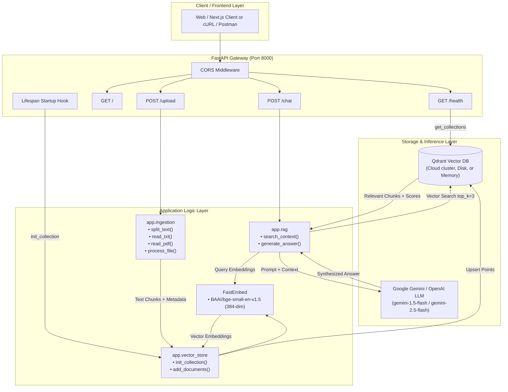
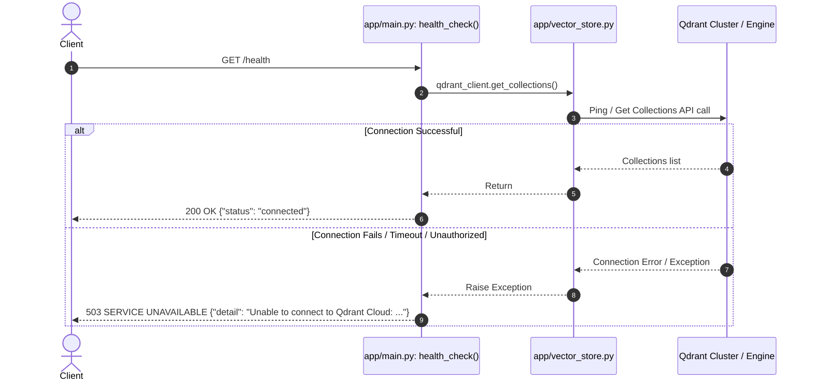
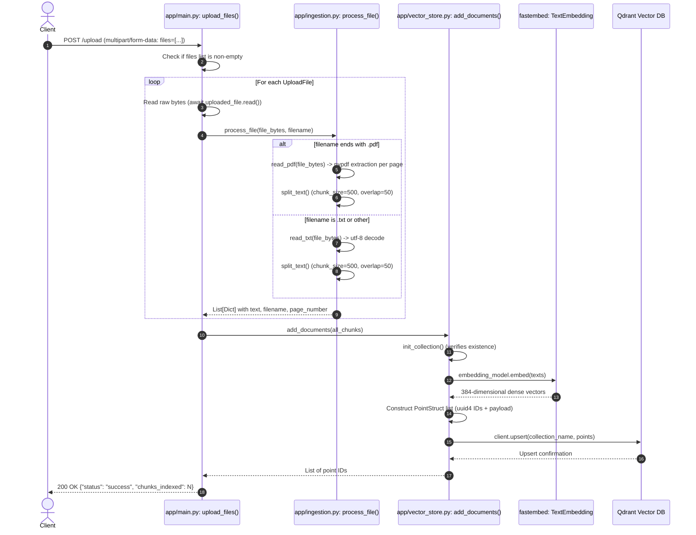
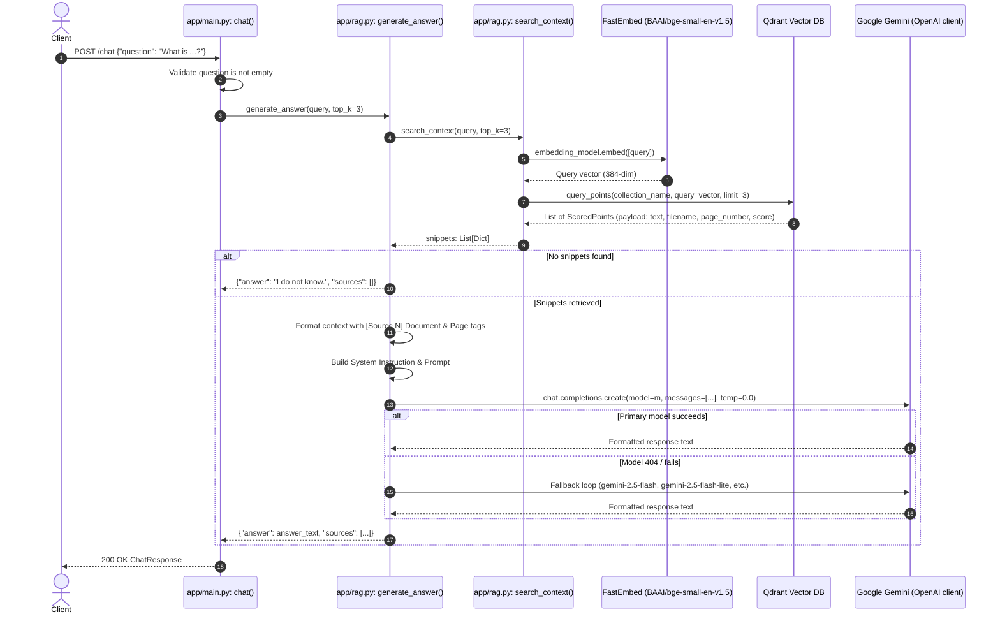

# Project Technical Study Material & Architecture Guide (HLD / LLD)

Welcome to the comprehensive technical documentation and study guide for the **FastAPI Qdrant RAG Service**. This document is designed for system architects, backend developers, and exam/interview preparation.

---

## 1. High-Level Design (HLD)

### 1.1 System Architecture Overview

The system implements an end-to-end **Retrieval-Augmented Generation (RAG)** pipeline designed to ingest unstructured documents (PDFs and TXT files), store dense vector representations, and query those vectors to ground Large Language Model (LLM) responses with exact page-level citations.



---

### 1.2 Core Architectural Principles & Components

| Component | Technology | Role & Key Responsibilities |
| :--- | :--- | :--- |
| **Web Server / Framework** | `FastAPI` + `Uvicorn` | Asynchronous REST API, OpenAPI/Swagger auto-generation, request validation via Pydantic, CORS handling, and startup/shutdown lifecycle. |
| **Document Processing** | `pypdf` + custom string chunker | Reads raw bytes, handles pagination (for PDFs), splits long texts into fixed-character sliding windows with overlap. |
| **Embedding Engine** | `FastEmbed` (`BAAI/bge-small-en-v1.5`) | Generates 384-dimensional dense vectors locally without requiring external paid embedding API calls. Fast, lightweight ONNX runtime. |
| **Vector Database** | `Qdrant` (`qdrant-client`) | Vector index with cosine distance metric. Supports multi-tier runtime: remote Qdrant Cloud cluster, local file persistence (`./qdrant_data`), or in-memory (`:memory:`). |
| **Inference Engine** | `OpenAI` client pointing to Google Generative Language API | Leverages Google Gemini using its OpenAI-compatible endpoint with automatic fallback across Gemini model variants (`gemini-1.5-flash`, `gemini-2.5-flash`, `gemini-2.5-flash-lite`, `gemini-2.5-pro`). |

---

## 2. Configuration & Lifecycle Deep Dive

### 2.1 Configuration (`app/config.py`)
- Uses `pydantic-settings` (with a resilient fallback to `os.getenv` if missing).
- Configured via `.env` file with parameters:
  - `QDRANT_URL`, `QDRANT_API_KEY`: Cluster credentials.
  - `GEMINI_API_KEY` (or `GOOGLE_API_KEY`, `OPENAI_API_KEY`): Authentication token.
  - `GEMINI_MODEL`: Primary target model (defaults to `gemini-1.5-flash`).
  - `GEMINI_BASE_URL`: Defaults to `https://generativelanguage.googleapis.com/v1beta/openai/`.
  - `QDRANT_COLLECTION_NAME`: Defaults to `rag_collection`.
  - `EMBEDDING_MODEL_NAME`: Defaults to `BAAI/bge-small-en-v1.5`.
- Cached via `@lru_cache()` as a singleton `settings` object.

### 2.2 Application Lifespan (`@asynccontextmanager lifespan(app: FastAPI)`)
When Uvicorn launches:
1. **Startup**: Calls `init_collection()` from `app.vector_store` to guarantee the Qdrant collection exists and matches the required vector dimension (384) and distance metric (Cosine).
2. **Yield**: FastAPI begins accepting incoming HTTP requests.
3. **Shutdown**: Attempts to gracefully close `qdrant_client.close()`.

---

## 3. Detailed Request-Response Sequences & Endpoint Execution

---

### 3.1 Endpoint: `GET /health`
Verifies network connectivity and authentication against the Qdrant cluster.

#### Sequence Diagram


---

### 3.2 Endpoint: `POST /upload`
Ingests document files, splits them into semantic chunks with metadata, generates vector embeddings, and indexes them into Qdrant.

#### Sequence Diagram


---

### 3.3 Endpoint: `POST /chat`
Accepts a natural language question, searches vector space for top-$k$ nearest neighbors, formats context with page citations, and prompts the LLM to generate an answer.

#### Sequence Diagram


---

## 4. Module & Function-by-Function Reference

### 4.1 Ingestion Module (`app/ingestion.py`)

#### `split_text(text: str, chunk_size: int = 500, chunk_overlap: int = 50) -> List[str]`
- **Mechanism**: Sliding character window.
- **Formula**: `step = chunk_size - chunk_overlap` (step = 450 characters).
- **Behavior**:
  - Starts at index `0`. Extracts slice `text[0:500]`.
  - Next slice starts at `start + step = 450`. Extracts slice `text[450:950]`.
  - Preserves 50 characters of contextual overlap across consecutive chunks to avoid cutting key phrases in half.

#### `read_txt(file_bytes: bytes, filename: str, chunk_size=500, chunk_overlap=50) -> List[Dict[str, Any]]`
- Decodes bytes using `utf-8` with error replacement.
- Splits into chunks via `split_text`.
- Attaches metadata: `{"filename": filename, "page_number": 1, "metadata": {...}}`.

#### `read_pdf(file_bytes: bytes, filename: str, chunk_size=500, chunk_overlap=50) -> List[Dict[str, Any]]`
- Reads PDF binary stream using `pypdf.PdfReader(io.BytesIO(file_bytes))`.
- Iterates through `reader.pages` with 1-based index `page_idx`.
- Extracts plain text per page via `page.extract_text()`.
- Chunks text per page, preserving exact page numbers in the metadata payload for citation lookup.

#### `process_file(file_bytes: bytes, filename: str, ...) -> List[Dict[str, Any]]`
- Dispatcher function: checks filename extension case-insensitively. Calls `read_pdf()` for `.pdf` files, defaults to `read_txt()` for all others.

---

### 4.2 Vector Store Module (`app/vector_store.py`)

#### `_init_qdrant_client() -> QdrantClient`
- Implements a resilient 3-way connection strategy:
  1. **Remote Cloud Cluster**: If `QDRANT_URL` is set and does not contain placeholder tokens.
  2. **In-Memory (`:memory:`)**: If `QDRANT_URL` is specified as `":memory:"`.
  3. **Embedded Local Persistence**: Fallback to `./qdrant_data` disk storage, allowing local execution without external cloud accounts.

#### `init_collection(collection_name: str, vector_size: int = 384) -> bool`
- Checks if the collection exists via `client.collection_exists()`.
- If missing, creates collection with `models.VectorParams(size=384, distance=models.Distance.COSINE)`.

#### `add_documents(chunks: Union[List[Dict], Dict, str], collection_name: str) -> List[str]`
- Ensures collection initialization.
- Normalizes chunk input structure into separate `texts` and `payloads` lists.
- Executes batch embedding via `embedding_model.embed(texts)`.
- Generates a `uuid.uuid4()` point ID for each chunk.
- Builds `models.PointStruct` items and commits them via `client.upsert()`.

---

### 4.3 RAG Core Module (`app/rag.py`)

#### `get_llm_client() -> OpenAI`
- Reloads `.env` to pick up runtime updates.
- Instantiates an `OpenAI` client pointing to `GEMINI_BASE_URL` (`https://generativelanguage.googleapis.com/v1beta/openai/`) using `GEMINI_API_KEY`.
- If standard `OPENAI_API_KEY` is provided without Gemini base URL, falls back to native OpenAI endpoint.

#### `search_context(query: str, top_k: int = 3) -> List[Dict[str, Any]]`
- Converts the user query into a 384-dimensional dense vector via `embedding_model.embed([query])`.
- Queries Qdrant using `query_points` (with automatic fallback to `search`).
- Extracts payload fields (`text`, `filename`, `page_number`) and similarity scores.

#### `generate_answer(query: str, top_k: int = 3) -> Dict[str, Any]`
- Evaluates retrieved snippets. If empty, immediately returns `"I do not know."`.
- Synthesizes structured context:
  ```text
  [Source 1] Document: report.pdf | Page: 3
  Content:
  ...chunk text...
  ```
- Strict system prompt:
  > *"Answer strictly using this context. Cite document name and page number. If not found, say I do not know."*
- Implements resilient multi-model failover:
  `primary_model` $\rightarrow$ `gemini-2.5-flash` $\rightarrow$ `gemini-2.5-flash-lite` $\rightarrow$ `gemini-flash-latest` $\rightarrow$ `gemini-2.5-pro`.
- Returns final answer and citation list.

---

## 5. Summary Cheat Sheet for Interviews & System Review

| Question | Answer |
| :--- | :--- |
| **Why FastEmbed instead of OpenAI Embeddings?** | FastEmbed runs locally on ONNX runtime (`bge-small-en-v1.5`), offering sub-millisecond latencies, zero cost, and zero external network dependencies for embeddings. |
| **Why Cosine Distance?** | Cosine distance measures vector direction rather than magnitude, which is standard for normalized dense text embeddings. |
| **How does Citation work?** | Metadata (`filename`, `page_number`) is preserved through chunking and stored in Qdrant's payload. RAG injects these tags into the LLM context prompt and instructs the model to cite them. |
| **How is LLM hallucination mitigated?** | System temperature is set to `0.0`, strict context constraints are enforced, and fallback to *"I do not know"* occurs when context is missing. |
| **How does local execution work without cloud keys?** | `vector_store.py` detects missing or placeholder cloud URLs and automatically falls back to an embedded Qdrant instance stored locally in `./qdrant_data`. |
